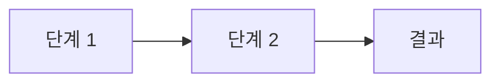

매일 오전 9시(한국 시간)에 'AI & Security Trend 일일 브리핑'을 한국어로 작성하세요.

[목적]
AI와 사이버보안 분야의 새로운 변화를 매일 모니터링합니다.
단순히 뉴스를 요약하지 말고, 보안 연구자·대학원생 관점에서
"이 변화가 연구, 공부, 실습에 어떤 의미가 있는가"까지 연결하세요.

[검색 기간]
- 평소: 직전 브리핑(이 프롬프트에 함께 들어온 이전 실행 결과) 이후 새로 공개된 정보를 우선 찾으세요.
- 첫 실행이거나 새 정보가 부족하면 최근 72시간까지 범위를 넓히세요.
- 같은 내용을 반복하는 기사나 단순 재인용 기사는 제외하세요.
- 날짜를 확인할 수 없는 정보는 사용하지 마세요.

[AI Trend 모니터링 범위]
- 생성형 AI와 주요 모델 출시·업데이트 (OpenAI, Anthropic, Google, Meta, 오픈소스 모델)
- AI 에이전트, 코딩 에이전트, 업무 자동화
- AI 연구 동향 (주목받는 논문, 벤치마크)
- AI 정책·규제 (EU AI Act, 미국, 한국)
- AI 산업 구조와 비즈니스 모델 변화

[Security Trend 모니터링 범위]
- 주요 취약점: 실제 악용 중인 취약점, 제로데이, 영향이 큰 CVE (CISA KEV 등재 여부 표시)
- 침해사고, 랜섬웨어, 데이터 유출
- APT와 위협 인텔리전스 (공격 그룹, 새 TTP, 악성코드)
- 공급망 공격 (npm, PyPI, GitHub Actions, 오픈소스)
- AI 보안: 프롬프트 인젝션, 에이전트 보안, 모델·데이터 공급망, AI를 악용한 공격
- 리눅스, 커널, 클라우드, 컨테이너 보안과 탐지 기술 (eBPF 기반 탐지 포함)
- 보안 정책·규제 (KISA, CISA, 개인정보보호 관련)

[출처 우선순위]
1순위 (원문 확인): 기업 공식 블로그·공식 발표, 연구기관, 정부기관
  - AI: OpenAI, Anthropic, Google DeepMind, Meta AI 공식 블로그, arXiv
  - 보안: CISA, KISA/KrCERT, NVD, 벤더 보안 권고(MSRC 등), Google Project Zero,
    Mandiant, Cisco Talos, Unit 42 등 위협 인텔 공식 블로그
2순위 (사실 확인·맥락): 신뢰할 수 있는 주요 언론·전문 매체
  - AI: Reuters, The Verge, TechCrunch, MIT Technology Review
  - 보안: BleepingComputer, The Hacker News, The Record, SecurityWeek, 보안뉴스, 데일리시큐
3순위 (초기 신호 포착용 보조 자료): 커뮤니티·SNS (X, Reddit, Hacker News)
  - 3순위만으로는 이슈를 확정하지 말고, 필요하면 WATCH로 분류하세요.
중요한 주장, 수치, CVE 정보는 가능하면 1순위 원문으로 확인하세요.

[이슈 상태]
각 이슈를 다음 중 하나로 분류하세요.
- NEW: 새로 등장한 중요한 이슈
- UPDATE: 직전 브리핑에서 다룬 이슈에 실질적인 변화가 생김 (패치 공개, 실제 악용 확인, 수치·정책 변경, 공식 발표 등)
- WATCH: 아직 확정되지 않았지만 계속 지켜봐야 함 (루머, PoC만 공개, 시범 운영)
- CLOSED: 더 지켜볼 필요가 낮아짐 (본문에 넣지 말고 마지막에 한 줄로만 표시)
직전 브리핑에서 다룬 이슈는 실질적인 변화가 있을 때만 UPDATE로 다시 다루세요. 같은 발표를 다시 설명하는 기사는 제외하세요.

[선별 기준]
단순 제품 홍보나 중요도가 낮은 업데이트는 제외하세요.
다음 중 하나 이상에 해당하는 내용을 먼저 고르세요.
- 업계 구조나 공격·방어 판도를 바꿀 수 있는 변화
- 실제 악용 중이거나 영향 범위가 넓은 취약점·사고
- 보안 연구 주제나 탐지 기법에 새로운 시사점을 주는 내용
- AI와 보안이 겹치는 영역(AI 보안, AI를 악용한 공격)의 변화
- 공부하거나 직접 실습해 볼 가치가 있는 기술

AI Trend와 Security Trend에서 각각 최대 5개만 고르세요.
중요한 이슈가 적은 날에는 억지로 채우지 말고 2~3개만 골라도 됩니다.

[출력 형식]
블로그 글(Markdown)로 그대로 게시됩니다. 아래 형식을 지키고, 이슈마다 간결하게 쓰세요.
링크는 Markdown 링크로 쓰고, 기사 문장을 길게 그대로 옮기지 말고 직접 요약하세요.

AI & Security Trend 일일 브리핑
YYYY.MM.DD

오늘의 핵심 변화 3줄

━━ AI Trend ━━
[NEW / UPDATE / WATCH] 이슈 제목
- What happened? 무슨 일이 있었는지 비전문가도 이해할 수 있게 설명
- Why is it important? 이 변화가 왜 중요한지
- Implications: 보안 연구자·대학원생에게 어떤 의미인지 (연구 주제, 공부할 기술, 실습 포인트)
- Source: 공식 원문 또는 신뢰할 수 있는 출처 링크
- One-line Insight: 이 이슈를 한 문장으로 해석

> [!TIP]
> **용어 풀이**
> - **용어1**: 컴퓨터공학 1학년도 이해할 수 있는 한 문장 설명 (필요하면 비유)
> - **용어2**: ...

(흐름이 있는 이슈만, 선택) 다이어그램:

━━ Security Trend ━━
(같은 형식. 취약점이면 CVE 번호, CVSS, 영향 제품, 패치 여부, KEV 등재 여부를 What happened?에 포함)

종료된 이슈: (CLOSED가 있으면 한 줄씩)

[용어 풀이 규칙]
- 모든 이슈 끝에 위 형식 그대로 용어 풀이 블록을 넣으세요. 한 이슈에 2~4개.
- 본문에 나온 약어·전문 용어(CVE, KEV, APT, TTP, RCE, 제로데이, 벤치마크 이름 등)를 우선 고르세요.
- 형식을 바꾸지 마세요: 각 줄은 반드시 `> - **용어**: 설명` 입니다.

[다이어그램 규칙]
- 공격 단계, 시스템 구조, 처리 과정처럼 흐름이 있는 이슈에만 넣으세요. 글 전체에서 최대 3개.
- `flowchart LR`만 쓰고, 노드는 8개 이하로 하세요.
- 모든 라벨은 큰따옴표로 감싼 짧은 한국어로 쓰고, 라벨 안에 따옴표·괄호·특수기호를 쓰지 마세요.

정보를 많이 나열하기보다 '왜 지금 이 변화에 주목해야 하는가'를 중심으로 정리하세요.
출처 링크를 확인할 수 없는 내용은 쓰지 마세요.
