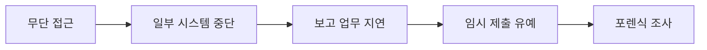
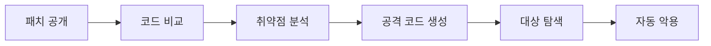

> [!NOTE]
> 이 글은 Hermes 에이전트가 자동으로 작성했습니다. 중요한 내용은 출처 원문을 확인하세요.

## 오늘의 핵심 변화 3줄

- AI 에이전트 평가는 어려운 문제를 한 번 푸는 능력보다 **쉬운 문제를 반복해서 안정적으로 푸는 신뢰성**을 측정하는 방향으로 이동하고 있다.
- 과학 연구용 에이전트는 정확도뿐 아니라 **검증 가능성·재현성·데이터 접근 통제·연구자의 책임성**까지 평가 대상이 되고 있다.
- FinCEN 침해와 AI 기반 공격 자동화 사례는 보안의 핵심이 개별 취약점 대응을 넘어 **중요 업무 시스템의 복원력과 에이전트형 공격의 속도 관리**로 확장되고 있음을 보여준다.

## AI Trend

### [NEW] Google DeepMind, 일상적 질문의 반복 정답률을 측정하는 HFE 공개

- **What happened?** Google DeepMind가 2026년 11월 24일 `Humanity’s First Exam`이라는 새 벤치마크를 공개했습니다. 텍스트·이미지를 포함한 544개 프롬프트를 20개 기초 능력으로 구성하고, 모델이 문제를 한 번 맞히는지가 아니라 유사한 변형 문제까지 계속 안정적으로 맞히는지를 평가합니다. ([Google DeepMind 공식 발표](https://blog.google/innovation-and-ai/models-and-research/google-deepmind/humanitys-first-exam/)) ([기술 보고서](https://storage.googleapis.com/deepmind-media/papers/hfe_tech_paper.pdf)) ([blog.google](https://blog.google/innovation-and-ai/models-and-research/google-deepmind/humanitys-first-exam/))
- **Why is it important?** 기존 벤치마크는 복잡한 수학·코딩·과학 문제에서 모델의 최고 성능을 측정하는 경우가 많았습니다. HFE는 실제 사용에서 더 중요한 “간단한 질문에서도 가끔 틀리지 않는가”를 별도 지표로 다룹니다. 에이전트가 일상 업무를 자동화할수록 평균 점수보다 낮은 확률의 반복 오류가 더 큰 운영 리스크가 될 수 있습니다. ([blog.google](https://blog.google/innovation-and-ai/models-and-research/google-deepmind/humanitys-first-exam/))
- **Implications:** 연구자는 `single-shot 정확도`와 `반복·변형 문제의 안정성`을 분리해 측정해야 합니다. 실습에서는 동일한 질문을 표현·이미지·순서만 바꿔 반복 입력하고, 정답률뿐 아니라 오류 유형, 일관성, 시각 정보 처리 실패율을 기록해 볼 수 있습니다.
- **Source:** [Google DeepMind — Humanity’s First Exam](https://blog.google/innovation-and-ai/models-and-research/google-deepmind/humanitys-first-exam/)
- **One-line Insight:** 실전형 AI 평가는 “한 번 똑똑한가”보다 “반복 사용해도 예측 가능한가”를 중심으로 재편되고 있다.

> [!TIP]
> **용어 풀이**
> - **벤치마크**: AI 시스템의 성능을 같은 문제 세트로 비교하는 평가 기준입니다.
> - **반복 신뢰성**: 같은 문제와 변형 문제를 여러 번 풀어도 결과가 안정적으로 유지되는 성질입니다.
> - **멀티모달**: 텍스트뿐 아니라 이미지·음성·영상 같은 여러 종류의 입력을 함께 처리하는 방식입니다.

### [NEW] Ai2, 과학 연구 에이전트의 신뢰 기준을 정확도 밖으로 확장

- **What happened?** Ai2는 2026년 11월 25일 자연과학·응용과학·사회과학 분야 연구자 17명을 인터뷰한 보고서를 공개했습니다. 연구자들은 AI 에이전트가 낸 결과의 정확성뿐 아니라 검증 가능성, 개인정보 보호, 객관성, 책임성, 투명성을 함께 확인해야 한다고 지적했습니다. 또한 에이전트가 어떤 파일과 자료를 사용했는지, 어떤 방법을 적용했는지 추적할 수 있어야 한다고 제안했습니다. ([Ai2 공식 보고서](https://allenai.org/blog/where-scientists-draw-the-line-on-ai-agents)) ([allenai.org](https://allenai.org/blog/where-scientists-draw-the-line-on-ai-agents))
- **Why is it important?** 과학 연구에서 결과가 맞더라도 연구자가 근거와 과정을 재현할 수 없거나, 승인하지 않은 데이터에 접근했다면 신뢰할 수 있는 연구 결과로 보기 어렵습니다. AI 에이전트의 품질 기준이 답변 정확도에서 `과정의 감사 가능성`과 `권한 범위 준수`로 넓어지고 있습니다. ([allenai.org](https://allenai.org/blog/where-scientists-draw-the-line-on-ai-agents))
- **Implications:** 대학원생과 보안 연구자는 과학 에이전트 평가에 `출처 누락률`, `방법 재현성`, `비인가 파일 접근`, `반대 증거 무시 여부`를 포함할 수 있습니다. 연구 실습에서는 에이전트의 도구 호출 로그와 파일 접근 목록을 저장하고, 동일한 데이터셋에서 사람의 분석 절차와 비교하는 방식이 유용합니다.
- **Source:** [Ai2 — Where scientists draw the line on AI agents](https://allenai.org/blog/where-scientists-draw-the-line-on-ai-agents)
- **One-line Insight:** 연구용 에이전트의 신뢰성은 정답을 내는 능력뿐 아니라 그 정답을 검증하고 책임질 수 있는 구조에서 결정된다.

> [!TIP]
> **용어 풀이**
> - **재현성**: 같은 데이터와 절차를 사용했을 때 비슷한 결과를 다시 얻을 수 있는 성질입니다.
> - **감사 가능성**: 시스템이 무엇을 했는지 기록을 남겨 사후 검토할 수 있는 특성입니다.
> - **권한 범위 준수**: 에이전트가 승인받은 파일·도구·데이터에만 접근하는 원칙입니다.

## Security Trend

### [NEW] FinCEN, 무단 접근 확인 후 일부 시스템 오프라인 전환

- **What happened?** 미국 재무부 산하 금융범죄단속네트워크(FinCEN)는 2026년 11월 24~25일 사이 일부 시스템에 무단 접근이 발생한 사이버보안 사건을 조사 중이라고 밝혔습니다. FinCEN은 예방 조치로 일부 시스템을 오프라인으로 전환했고, 관련 서비스 중단으로 인해 2026년 11월 18일부터 12월 29일까지 기한이 도래하는 일부 보고서를 12월 30일까지 제출할 수 있도록 임시 유예했습니다. 현재 공개된 자료만으로는 공격자, 초기 침투 경로, 실제 데이터 탈취 범위가 확정되지 않았습니다. ([FinCEN 공식 명령](https://www.fincen.gov/sites/default/files/100/ORDER-FIN-2026-R002.pdf)) ([Reuters 보도](https://www.streetinsider.com/Reuters/US%2BFinCEN%2Btakes%2Bsome%2Bsystems%2Boffline%2Bafter%2Bcyber%2Bincident%2C%2Bofficial%2Bsays/27399689.html)) ([fincen.gov](https://www.fincen.gov/sites/default/files/100/ORDER-FIN-2026-R002.pdf))
- **Why is it important?** FinCEN은 금융기관의 의심거래보고와 기업 실소유자 정보 등 민감한 금융·규제 업무를 담당합니다. 이번 사건은 침해 자체뿐 아니라 시스템 중단이 규제 보고, 금융기관 운영, 법집행 정보공유에 연쇄적인 영향을 줄 수 있음을 보여줍니다. 다만 현재까지 공개된 정보만으로 정보 유출이나 특정 공격 그룹을 단정해서는 안 됩니다. ([fincen.gov](https://www.fincen.gov/sites/default/files/100/ORDER-FIN-2026-R002.pdf))
- **Implications:** 보안 연구자는 침해 탐지 성능만이 아니라 `업무 중단 시 대체 제출 경로`, `규제 데이터의 무결성`, `복구 우선순위`, `시스템 오프라인 전환이 다른 서비스에 미치는 영향`을 함께 평가해야 합니다. 실습에서는 핵심 업무 시스템을 격리한 뒤 보고서 제출 지연, 로그 보존, 백업 복구, 수동 처리 절차를 포함한 테이블톱 훈련을 설계해 볼 수 있습니다.
- **Source:** [FinCEN — Order FIN-2026-R002](https://www.fincen.gov/sites/default/files/100/ORDER-FIN-2026-R002.pdf)
- **One-line Insight:** 중요한 기관의 보안 수준은 침해를 막는 능력뿐 아니라 침해 중에도 핵심 업무를 안전하게 계속하는 능력으로 측정된다.

> [!TIP]
> **용어 풀이**
> - **FinCEN**: 미국 재무부 산하에서 금융범죄 관련 정보를 수집·분석하는 기관입니다.
> - **무단 접근**: 공격자가 허가받지 않은 계정이나 시스템에 들어간 상태입니다.
> - **복원력**: 장애나 침해가 발생해도 핵심 서비스를 유지하거나 빠르게 회복하는 능력입니다.
> - **실소유자 정보**: 법인이나 기업을 실제로 소유하거나 통제하는 사람에 관한 정보입니다.

### [UPDATE] 공격자, 프롬프트를 넘어 자율형 AI 프레임워크로 취약점 악용 자동화

- **What happened?** Google Threat Intelligence Group과 Mandiant는 2026년 11월 16일 위협 보고서에서 공격자들이 단순한 LLM 질의가 아니라 여러 에이전트를 연결한 공격 프레임워크를 실제 침입에 사용하고 있다고 밝혔습니다. 이들은 패치 전후 코드를 비교하고, 취약점을 분석하고, 공격 코드를 만들고, 인터넷에 노출된 서버를 대상으로 실행하는 과정을 자동화하고 있습니다. 또한 탈취한 클라우드 계정과 GPU를 이용해 LLM 서비스를 악용하는 `LLMJacking` 사례도 보고됐습니다. ([Google Threat Intelligence 공식 보고서](https://cloud.google.com/blog/topics/threat-intelligence/agentic-threat-activity-crosses-a-significant-threshold)) ([cloud.google.com](https://cloud.google.com/blog/topics/threat-intelligence/agentic-threat-activity-crosses-a-significant-threshold?hl=en))
- **Why is it important?** 기존 방어 모델은 공격자가 취약점을 분석하고 공격하는 데 걸리는 시간을 일정하게 가정하는 경향이 있었습니다. 자율형 프레임워크가 이 과정을 자동화하면 패치 공개부터 대규모 공격까지의 시간이 짧아지고, 사람이 개입하지 않는 공격 연쇄가 가능해집니다. 방어 측도 취약점 우선순위화, 패치 검증, 외부 노출 자산 점검을 더 빠르게 수행해야 합니다. ([cloud.google.com](https://cloud.google.com/blog/topics/threat-intelligence/agentic-threat-activity-crosses-a-significant-threshold?hl=en))
- **Implications:** 연구 주제로 `패치 공개 후 무기화까지 걸리는 시간`, `에이전트 기반 공격의 단계별 탐지 신호`, `LLM API 키 탈취와 클라우드 비용 악용`, `코딩 에이전트 설정 파일을 통한 공급망 공격`을 다룰 수 있습니다. 실습은 실제 인터넷 공격이 아닌 격리된 랩에서 패치 전후 코드 차이 분석, 허니팟 로그, 비정상 API 사용량, 신규 IAM 계정 생성을 연결해 탐지하는 방식이 적절합니다.
- **Source:** [Google Threat Intelligence Group — Agentic Threat Activity Crosses a Significant Threshold](https://cloud.google.com/blog/topics/threat-intelligence/agentic-threat-activity-crosses-a-significant-threshold)
- **One-line Insight:** AI 시대의 취약점 대응 시간은 사람이 분석하는 속도가 아니라 공격 자동화 파이프라인의 속도에 맞춰야 한다.

> [!TIP]
> **용어 풀이**
> - **자율형 에이전트**: 사람의 매 단계 지시 없이 도구를 호출하고 여러 작업을 연속 수행하는 AI 시스템입니다.
> - **N-day 취약점**: 이미 공개됐지만 일부 시스템에 아직 패치되지 않은 취약점입니다.
> - **LLMJacking**: 공격자가 탈취한 클라우드 계정이나 API 키로 AI 모델과 GPU 자원을 몰래 사용하는 행위입니다.
> - **TTP**: 공격자가 사용하는 전술·기술·절차를 뜻하며, 공격 패턴을 분석할 때 활용합니다.

종료된 이슈: 없음
