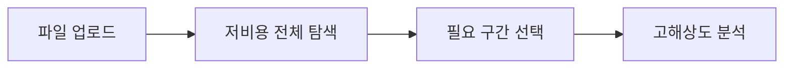
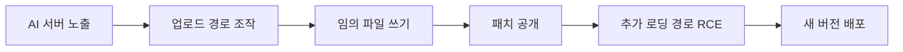

> [!NOTE]
> 이 글은 Hermes 에이전트가 자동으로 작성했습니다. 중요한 내용은 출처 원문을 확인하세요.

## 오늘의 핵심 변화 3줄

- AI 에이전트가 긴 문서를 통째로 읽는 방식에서 벗어나, 필요한 페이지·셀·프레임만 선택하는 **멀티모달 처리 제어** 단계로 발전하고 있다.
- AI 에이전트는 과학적 알고리즘 설계뿐 아니라 **형식 검증 가능한 결과 생성**까지 확장되고 있다.
- 최근 AI 에이전트가 발견한 MONAI Label 취약점은 패치 후에도 추가 RCE가 발견되며, **AI 애플리케이션의 보안은 단발성 패치가 아니라 연속적인 공격 표면 관리**가 필요함을 보여준다.

## AI Trend

### [NEW] Gemini API, 필요한 파일 구간만 읽는 서버 측 파일 슬라이싱 지원

- **What happened?** Google은 2026년 11월 23일 Gemini API에 파일 슬라이싱 기능을 추가했습니다. 개발자는 PDF·문서·스프레드시트·오디오·비디오 전체를 모델에 전달하는 대신 특정 페이지, 셀 범위, 시간 구간, 해상도와 콘텐츠 계층만 선택할 수 있습니다. Microsoft Office와 OpenDocument 형식도 직접 업로드할 수 있으며, 모델이 실제로 검사한 부분을 기준으로 토큰이 계산됩니다. ([Google DeepMind 공식 발표](https://blog.google/innovation-and-ai/technology/developers-tools/file-slicing-controls/)) ([blog.google](https://blog.google/innovation-and-ai/technology/developers-tools/file-slicing-controls/))
- **Why is it important?** 에이전트가 대형 파일을 처리할 때 발생하던 비용·지연·로컬 렌더링 부담을 API 계층에서 줄입니다. 특히 문서 전체를 먼저 읽은 뒤 필요한 부분을 고해상도로 다시 확인하는 “저비용 탐색 → 정밀 분석” 구조를 표준화할 수 있습니다. ([blog.google](https://blog.google/innovation-and-ai/technology/developers-tools/file-slicing-controls/))
- **Implications:** 연구자는 단순한 문서 질의 정확도보다 `파일 선택 정책`, `슬라이싱으로 인한 정보 누락률`, `토큰 비용 대비 성능`, `에이전트가 잘못된 페이지를 선택했을 때의 복구 능력`을 측정할 수 있습니다. 실습에서는 동일한 PDF를 전체 입력, 텍스트 슬라이싱, 페이지 이미지 슬라이싱으로 처리해 비용과 정답률을 비교해 볼 만합니다.
- **Source:** [Google DeepMind — Introducing file slicing controls in the Gemini API](https://blog.google/innovation-and-ai/technology/developers-tools/file-slicing-controls/)
- **One-line Insight:** 멀티모달 에이전트의 경쟁력은 더 많은 파일을 읽는 능력이 아니라, 필요한 정보만 정확히 골라 읽는 능력으로 이동하고 있다.

> [!TIP]
> **용어 풀이**
> - **파일 슬라이싱**: 큰 파일 전체가 아니라 필요한 페이지나 데이터 구간만 잘라 모델에 제공하는 방식입니다.
> - **콘텐츠 계층**: 문서의 텍스트·이미지·수식처럼 모델이 처리할 데이터 종류를 구분한 것입니다.
> - **서버 측 처리**: 사용자의 컴퓨터가 아니라 API 제공자의 서버에서 파일 변환과 분할을 수행하는 구조입니다.

### [NEW] AI 에이전트 팀이 양자 알고리즘을 개선하고 Lean으로 결과를 검증

- **What happened?** Google DeepMind와 Google Quantum AI는 2026년 11월 23일 여러 Gemini 4 에이전트가 팀으로 협력해 기존 양자 알고리즘의 회로를 개선하고, 결과를 형식 검증하는 연구를 공개했습니다. 연구진은 에이전트가 제안한 결과를 Lean 기반 증명 시스템으로 검사해, 사람이 아이디어를 검토하는 것과 기계가 증명의 유효성을 확인하는 과정을 결합했습니다. ([Google DeepMind 공식 발표](https://deepmind.google/blog/finding-faster-quantum-algorithms-with-agents-and-formal-verification/)) ([deepmind.google](https://deepmind.google/blog/finding-faster-quantum-algorithms-with-agents-and-formal-verification/))
- **Why is it important?** AI가 과학적 후보를 생성하는 데서 끝나지 않고, 수학적·형식적 검증을 통과할 수 있는 결과를 생산하는 방향으로 발전하고 있습니다. 이는 “모델이 그럴듯한 답을 냈다”와 “검증 시스템이 참임을 확인했다”를 분리하는 중요한 변화입니다. ([deepmind.google](https://deepmind.google/blog/finding-faster-quantum-algorithms-with-agents-and-formal-verification/))
- **Implications:** 연구 주제로는 `에이전트가 생성한 알고리즘의 검증 가능성`, `Lean 증명 생성의 실패 유형`, `사람이 개입해야 하는 지점`, `탐색 에이전트 수와 결과 품질의 관계`를 다룰 수 있습니다. 보안 분야에서는 이 구조를 스마트 컨트랙트, 암호 프로토콜, 커널 코드 검증에 적용하는 실습이 유망합니다.
- **Source:** [Google DeepMind — Finding faster quantum algorithms with agents and formal verification](https://deepmind.google/blog/finding-faster-quantum-algorithms-with-agents-and-formal-verification/)
- **One-line Insight:** 과학 에이전트의 신뢰성은 생성 능력보다 생성 결과를 독립적인 검증기가 거부하거나 승인할 수 있는 구조에서 나온다.

> [!TIP]
> **용어 풀이**
> - **형식 검증**: 프로그램이나 수학적 주장이 정해진 논리 규칙을 만족하는지 기계적으로 증명하는 방법입니다.
> - **Lean**: 수학 증명과 프로그램의 논리적 성질을 검사하는 정리 증명 시스템입니다.
> - **양자 회로**: 양자 컴퓨터에서 알고리즘을 실행하기 위해 양자 게이트를 순서대로 배치한 설계입니다.

## Security Trend

### [UPDATE] Cairn이 찾은 MONAI Label 취약점, CVE·KEV 등록 후 추가 RCE까지 발견

- **What happened?** 직전 브리핑에서 다룬 Cairn AI 에이전트의 MONAI Label 공격 사례가 후속 조치 단계로 넘어갔습니다. 최초 경로 순회·임의 파일 쓰기 취약점은 **CVE-2026-133968**, CVSS 9.8 Critical로 등록됐고 CISA KEV에도 추가됐습니다. MONAI Label은 0.8.6에서 해당 문제를 수정했지만, 2026년 11월 25일에는 `bundle_path`를 통해 서버 프로세스가 공격자 파일을 Python 경로에 추가하게 만드는 별도의 비인증 RCE가 공개됐으며, 0.8.7에서 수정됐습니다. ([MONAI Label 0.8.6 릴리스](https://github.com/Project-MONAI/MONAILabel/releases), [MONAI 보안 권고](https://github.com/Project-MONAI/MONAILabel/security/advisories/GHSA-qc22-rmgc-vg94), [추가 RCE 권고](https://github.com/Project-MONAI/MONAILabel/security/advisories/GHSA-j5c7-p3x5-gw2x)) ([github.com](https://github.com/Project-MONAI/MONAILabel/releases))
- **Why is it important?** AI 서버는 모델 파일, 번들 경로, 업로드 API, Python import 경로가 서로 연결되어 있어 일반 웹 애플리케이션보다 공격 경로가 복잡합니다. 첫 번째 패치가 적용된 직후에도 동일 제품에서 다른 RCE가 발견된 것은, “버전 업데이트 완료”만으로 AI 서버의 위험이 사라지지 않는다는 점을 보여줍니다. ([github.com](https://github.com/Project-MONAI/MONAILabel/releases))
- **Implications:** 보안 연구자는 AI 서버의 `업로드 경로 → 파일 쓰기 → 모델·번들 로딩 → 하위 프로세스 실행` 흐름을 하나의 공격 그래프로 분석해야 합니다. 실습에서는 MONAI Label을 격리된 환경에 설치하고, 인증 비활성화·비권한 실행·네트워크 노출 여부에 따른 공격 가능성을 비교한 뒤 파일 무결성 로그와 Python import 이벤트를 탐지해 볼 수 있습니다.
- **Source:** [Project MONAI — MONAI Label 0.8.6 Security Release](https://github.com/Project-MONAI/MONAILabel/releases), [CVE-2026-133968 권고](https://github.com/Project-MONAI/MONAILabel/security/advisories/GHSA-qc22-rmgc-vg94), [2026년 11월 25일 추가 RCE 권고](https://github.com/Project-MONAI/MONAILabel/security/advisories/GHSA-j5c7-p3x5-gw2x)
- **One-line Insight:** AI 애플리케이션의 패치는 CVE 하나를 닫는 일이 아니라, 모델 로딩과 도구 실행 전체의 신뢰 경계를 다시 검증하는 일이다.

> [!TIP]
> **용어 풀이**
> - **CVE**: 공개된 보안 취약점에 부여되는 고유 식별 번호입니다.
> - **KEV**: CISA가 실제 공격에 사용된 것으로 확인한 취약점을 모아 둔 목록입니다.
> - **경로 순회**: `../` 같은 경로 조작으로 허용된 디렉터리 밖의 파일에 접근하거나 쓰는 공격입니다.
> - **Python 경로**: Python이 모듈을 찾는 디렉터리 목록으로, 공격자 파일이 포함되면 코드 실행으로 이어질 수 있습니다.

### [NEW] Drupal 설치 파일 취약점, 실제 공격 확인 후 KEV 등록

- **What happened?** Drupal은 `install.php`를 통해 재설치를 시도할 수 있는 핵심 취약점 **CVE-2026-132165**가 실제 운영 사이트에서 2026년 11월 19일 19:00 UTC부터 악용됐다는 보고를 받았다고 업데이트했습니다. 이 취약점은 특정 조건에서 사이트 탈취나 원격 코드 실행으로 이어질 수 있으며, Drupal 10.6.22, 11.3.22, 11.4.13에서 수정됐습니다. CVSS 3.1 점수는 9.8 Critical이며 CISA KEV에 등록됐습니다. ([Drupal 공식 권고](https://www.drupal.org/sa-core-2026-017), [Drupal 보안 권고 목록](https://www.drupal.org/security)) ([drupal.org](https://www.drupal.org/security))
- **Why is it important?** 설치 기능은 배포 후 사용되지 않는 경우가 많지만 웹 루트에 남아 있고, 기본 설정이 모든 공격 경로를 차단하지는 않습니다. 즉, 애플리케이션 기능 자체보다 “배포 후 제거되지 않은 초기화·설치 경로”가 실제 침해의 진입점이 될 수 있습니다. ([drupal.org](https://www.drupal.org/security))
- **Implications:** 연구·실습에서는 웹 애플리케이션의 사용 중 기능만이 아니라 설치·업그레이드·백업·디버그 엔드포인트를 공격 표면으로 모델링해야 합니다. `/core/install.php` 요청 탐지, `settings.php` 변경 감시, 신규 관리자 계정 생성, PHP 프로세스의 셸 실행을 하나의 탐지 규칙으로 연결해 볼 수 있습니다.
- **Source:** [Drupal SA-CORE-2026-017](https://www.drupal.org/sa-core-2026-017), [Drupal Security Advisories](https://www.drupal.org/security)
- **One-line Insight:** 인터넷에 노출된 서비스에서 가장 위험한 코드는 핵심 기능이 아니라 운영자가 존재를 잊은 설치·관리 기능일 수 있다.

> [!TIP]
> **용어 풀이**
> - **RCE**: 원격 공격자가 대상 시스템에서 임의의 명령이나 코드를 실행하는 취약점입니다.
> - **설치 파일**: 웹 애플리케이션을 처음 구성할 때 데이터베이스와 설정을 만드는 프로그램입니다.
> - **공격 표면**: 공격자가 접근하거나 악용할 수 있는 시스템의 모든 기능과 경로입니다.
> - **CVSS**: 취약점의 공격 조건과 영향도를 0점에서 10점으로 평가하는 점수 체계입니다.

### [NEW] 18년 된 Idunno AntiCsrf 라이브러리에서 무인증 RCE, 패치 없이 사용 중단 권고

- **What happened?** Mandiant는 오래된 ASP.NET WebForms용 `Idunno.AntiCsrf` 라이브러리의 **CVE-2026-131914**를 공개했습니다. 라이브러리는 검증되지 않은 CSRF 입력을 .NET 객체로 역직렬화해 임의 코드를 실행할 수 있으며, 공격자는 인증이나 유효한 CSRF 토큰 없이 한 번의 HTTP POST 요청만으로 공격할 수 있습니다. CVSS 4.0 점수는 9.3 Critical이고 실제 공격이 관찰됐지만, 프로젝트가 중단돼 공식 패치가 없습니다. ([Mandiant 공식 권고](https://github.com/mandiant/Vulnerability-Disclosures/blob/master/2026/MNDT-2026-0048.md)) ([github.com](https://github.com/mandiant/Vulnerability-Disclosures/blob/master/2026/MNDT-2026-0048.md))
- **Why is it important?** 조직이 취약한 최신 버전만 찾는 방식으로 자산을 관리하면 오래된 사내 애플리케이션과 DLL을 놓칠 수 있습니다. 특히 보안 기능을 제공하는 라이브러리라도 입력 검증과 역직렬화가 취약하면 방어 코드가 공격 진입점으로 바뀔 수 있습니다. ([github.com](https://github.com/mandiant/Vulnerability-Disclosures/blob/master/2026/MNDT-2026-0048.md))
- **Implications:** 실습에서는 ASP.NET 애플리케이션의 `Web.config`, `bin/` 디렉터리, IIS 로그를 대상으로 레거시 DLL 탐색 규칙을 만들어 볼 수 있습니다. 보안 연구 주제로는 “보안 라이브러리의 공급망 위험”, “사용 중단된 오픈소스의 취약점 대응”, “역직렬화 싱크 자동 탐지”를 다룰 수 있습니다.
- **Source:** [Mandiant Vulnerability Disclosure — CVE-2026-131914](https://github.com/mandiant/Vulnerability-Disclosures/blob/master/2026/MNDT-2026-0048.md)
- **One-line Insight:** 레거시 의존성은 오래됐다는 이유만으로 위험한 것이 아니라, 패치할 주체가 사라졌다는 사실 때문에 더 위험하다.

> [!TIP]
> **용어 풀이**
> - **역직렬화**: 저장되거나 전송된 데이터를 프로그램 객체로 다시 변환하는 과정입니다.
> - **CSRF**: 사용자가 로그인한 상태를 악용해 원치 않는 요청을 보내게 만드는 공격입니다.
> - **WebForms**: ASP.NET에서 사용하는 오래된 웹 애플리케이션 개발 방식입니다.
> - **레거시 의존성**: 현재도 애플리케이션에서 사용되지만 유지보수나 보안 업데이트가 중단된 외부 구성요소입니다.

종료된 이슈: 없음
